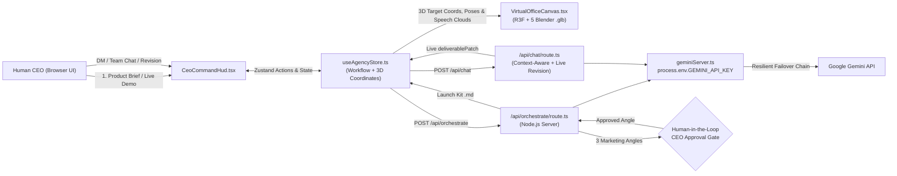

<p align="center">
  
</p>

<h3 align="center">From Raw Idea to Launch-Ready Digital Product — Orchestrated by Autonomous Agents.</h3>

<p align="center">
  
  
  
  
  
  
</p>

---

**BrickLaunch Studio** adalah aplikasi web **Autonomous Digital Product Launch Agency** yang menggabungkan **simulasi kantor virtual 3D interaktif (WebGL / Blender `.glb`)** dengan **orkestrasi multi-agent AI nyata berbasis Google Gemini API**.

Sebagai **Human CEO**, kamu cukup memasukkan ide produk digital mentah — lalu saksikan 3 karakter Lego minifigure AI (**Alex**, **Maya**, dan **Leo**) berjalan, duduk di kursi kerja, berdiskusi melalui balon awan pesan 3D, meminta persetujuanmu di Gerbang ACC (**Human-in-the-Loop**), menerima revisi langsung lewat DM/Chat, hingga mencetak **Launch Kit Markdown (`.md`)** di mesin fotokopi kantor.

---

## Identitas Brand & Pemetaan Ortografis

<p align="center">
  
</p>

| Aset Brand | Lokasi File | Penempatan di UI & Metadata | Fungsi |
| :--- | :--- | :--- | :--- |
| **Favicon & App Icon** *(Mark piramida 3 tingkat lego brick + panah peluncuran diagonal di atas latar `#141517`)* | `src/app/icon.svg` & `public/brand/bricklaunch-icon.svg` | `<head>` metadata (`icon`, `shortcut`, `apple`), tab browser `16×16` / `32×32`, dan bookmark | Ikon presisi tinggi tanpa teks agar tetap tajam pada ukuran mikro |
| **Horizontal Header Lockup** *(Icon Mark di kiri + `Brick` putih + `Launch` `#F04A1A` + `STUDIO` rata kanan)* | `src/components/ui/BrickLaunchLogo.tsx` & `public/brand/bricklaunch-logo-horizontal.svg` | Top Bar HUD, Header Modal *Agency Profile / How It Works*, OpenGraph & Hero README | Identitas utama studio di antarmuka web dan pratinjau tautan |

### Palet Warna Brand
- **Brick Launch Orange:** `#FF521B` → `#E84118` → `#B93110` (energi peluncuran, aksen CTA, serpihan momentum)
- **Studio Pure White:** `#FFFFFF` (tipografi `Brick`, `STUDIO`, dan kontras bersih)
- **Obsidian Charcoal:** `#141517` / `#0F172A` (latar belakang elegan untuk menonjolkan pencahayaan studio 3D)

---

## Tech Stack

| Kategori | Teknologi | Peran dalam Sistem |
| :--- | :--- | :--- |
| **Framework & Runtime** | Next.js 15 (App Router, Node.js Runtime) + React 19 + TypeScript 5 | SSR-safe routing, Server API Routes (`/api/orchestrate`, `/api/chat`), production bundling |
| **AI & Multi-Agent Engine** | `@google/genai` (Google Gemini SDK) | Orkestrasi riset pasar, sintesis 3 marketing angle, penulisan Launch Kit, dan chat revisi live dengan failover model otomatis (`gemini-3.5-flash-lite` → `gemini-3.1-flash-lite` → `gemini-3.8-flash` → `gemma-4`) |
| **3D Engine & WebGL** | Three.js, `@react-three/fiber` v9, `@react-three/drei` v10 | Render 5 aset Blender `.glb`, animasi sendi minifigure Lego (jalan, duduk 90°, mengetik, kopi, melambai, copier), `<Environment>`, `<ContactShadows>`, `<OrbitControls>` |
| **State & Spatial Choreography** | Zustand v5 (`src/store/useAgencyStore.ts`) | Mesin state tunggal yang menyinkronkan fase orkestrasi AI, koordinat spasial 3D, rotasi aktivitas standby, log telemetri, dan jendela obrolan |
| **UI & Styling** | Tailwind CSS v4 + Lucide React | Floating Glassmorphism HUD yang bisa digulir & dibentangkan (*collapsible/expandable*), Mode Lega, Approval Modal, dan Tabbed Deliverable Drawer |

---

## Definisi Arsitektur Sistem

BrickLaunch Studio memisahkan secara ketat **lapisan keamanan AI di server** dan **lapisan koreografi 3D + HUD di browser** (*Zero Client API Key Exposure*):



### Prinsip Arsitektur & Keamanan
1. **Zero Client API Key Exposure:** `process.env.GEMINI_API_KEY` (dengan fallback `process.env.GOOGLE_API_KEY`) hanya pernah dibaca di server pada `src/lib/geminiServer.ts`. Tidak ada input API key, modal pengaturan key, atau penyimpanan `localStorage` di frontend.
2. **Resilient Multi-Model Failover:** Wrapper `generateWithResilience()` menerapkan konfigurasi standar (`temperature: 0.7`, `maxOutputTokens: 1200` untuk orkestrasi / `500` untuk chat cepat, tanpa parameter eksperimental seperti `thinkingConfig`), dilengkapi timeout cepat dan failover lintas bucket kuota model untuk ketahanan terhadap lonjakan `503`/`429`.
3. **Hydration-Safe & Optimized WebGL:** Kedua komponen utama (`VirtualOfficeCanvas` dan `CeoCommandHud`) menggunakan guard `isMounted` serta `ssr: false` dengan `<Canvas dpr={[1, 1.5]}>` dan `<Html>` yang ter-mount permanen (bebas error unmount sinkron React 19).
4. **Live Revision Loop via Chat:** Setiap pesan DM ke Alex/Leo otomatis membawa konteks proyek penuh (`ceoBrief`, `researchSummary`, `selectedAngle`, `finalDeliverable`). Ketika terdeteksi niat revisi, server memperbarui bagian Launch Kit terkait dan langsung memicu animasi Leo bekerja → mencetak ulang di copier → memperbarui file `.md`.

---

## Seluruh Peran Agent (Lego Minifigure Roster)

| Agent | Peran & Judul | Warna Seragam | Zona Meja | Kepribadian & Tanggung Jawab |
| :--- | :--- | :--- | :--- | :--- |
| **Alex** (`manager`) | **AI Manager / Handoff Orchestrator** | `#1E293B` *(Dark Navy Suit)* · Aksen `#60A5FA` | `MANAGER_DESK` `[-3.5, 0, -2.5]` | **Tenang, terstruktur, tegas, dan suportif.** Menerima brief CEO, mendelegasikan riset ke Maya, menyintesis 3 Marketing Angle kontras, menahan alur di gerbang ACC CEO, melakukan QA, serta mengoordinasikan permintaan revisi dari DM. |
| **Maya** (`researcher`) | **Market & Consumer Psychology Researcher** | `#0284C7` *(Sky Blue Shirt)* · Aksen `#38BDF8` | `RESEARCHER_DESK` `[-4.0, 0, 1.5]` | **Analitis, penasaran, dan data-driven.** Membedah pain point terdalam target audiens, memetakan psikologi pembelian, menemukan celah kompetitor, lalu menyerahkan dossier ke Meja Manager (mendukung Google Search Grounding opsional). |
| **Leo** (`copywriter`) | **Conversion Copywriter** | `#D97706` *(Amber Sweater)* · Aksen `#FBBF24` | `COPYWRITER_DESK` `[-1.0, 0, 1.5]` | **Punchy, kreatif, energik, dan fokus konversi.** Menerima angle yang di-ACC CEO untuk menulis **Copy Landing Page**, **Utas Viral 5-bagian X/Threads**, dan **Skrip Video Pendek 45 detik**, mencetaknya di Copier Zone, serta mengeksekusi revisi live via DM. |

### Alur Kerja 7-Tahap Human-in-the-Loop
1. **CEO Brief** — CEO mengetik ide produk digital atau mengklik 1-klik **Run Sample Launch Mission**.
2. **Maya Market & Psychology Research** — Alex mendelegasikan riset; Maya duduk di meja riset untuk membedah audiens & kompetitor.
3. **Alex Pre-Production Report** — Maya melakukan handoff ke Meja Manager; Alex merangkum **3 Marketing Angle** berbeda.
4. **CEO Approval Gate (HITL)** — Studio berhenti di modal persetujuan agar Human CEO menilai hasil riset dan memilih 1 angle pemenang.
5. **Leo Conversion Drafting** — Alex menyerahkan brief kreatif ke Leo; Leo duduk di workstation menulis seluruh paket copywriting.
6. **Alex QA & Live DM Revision Loop** — Alex memverifikasi kualitas; CEO dapat mengirim DM ke Leo/Alex kapan saja untuk merevisi copy secara live.
7. **Leo Copier Printing & `.md` Export** — Leo berjalan ke `COPIER_PRINTER_ZONE` (dengan lampu beacon & animasi kertas keluar) lalu menyerahkan **Launch Kit `.md`** siap unduh.

---

## Detail Profil Kantor Virtual 3D

Kantor virtual **BrickLaunch Studio** dirancang di atas bidang lantai arsitektural **12m × 10m** yang berpusat pada koordinat dunia `[0, 0, 0]` dengan pencahayaan studio hangat, bayangan lembut (`2048×2048`), dan `<OrbitControls>` yang terkunci di atas permukaan lantai.

### Peta Koordinat Zona Kantor (`OFFICE_ZONES`)

| Zona | Koordinat `[X, Y, Z]` | Aset 3D & Fungsi Operasional |
| :--- | :--- | :--- |
| **Office Room Shell** | `[0.0, 0.0, 0.0]` | `office_room.glb` diskalakan presisi ke `12m × 10m` (lantai oak, jendela kiri, acoustic slats, pintu belakang, aksen dinding sage-mint). |
| **Manager Desk (Alex)** | `[-3.5, 0.0, -2.5]` | `workstation_desk.glb` + kursi kerja ergonomis + laptop menyala + titik serah terima handoff di depan meja. |
| **Researcher Desk (Maya)** | `[-4.0, 0.0, 1.5]` | `workstation_desk.glb` + kursi ergonomis + indikator halo aktif saat Maya melakukan riset pasar. |
| **Copywriter Desk (Leo)** | `[-1.0, 0.0, 1.5]` | `workstation_desk.glb` + kursi ergonomis + layar menyala oranye saat Leo menulis Launch Kit & revisi. |
| **Copier / Printer Zone** | `[0.5, 0.0, -3.5]` | `office_copier.glb` lengkap dengan beacon LED status ungu berkedip & animasi lembaran kertas tercetak saat `PRINTING_DELIVERABLE`. |
| **Pantry Coffee Bar** | `[4.0, 0.0, -1.5]` | `pantry_bar.glb` (kabinet slate, meja quartz, kulkas, beverage cooler, mesin espresso & warm under-LED) sebagai zona istirahat kopi agent. |

### Katalog 5 Aset 3D Blender (`public/models/`)
- `office_room.glb` — Struktur cutaway isometrik ruang kantor modern.
- `workstation_desk.glb` — Meja workstation studio (di-instance 3× dengan material oak + rangka baja charcoal PBR).
- `pantry_bar.glb` — Unit kabinet pantry & bar kopi terintegrasi.
- `office_copier.glb` — Mesin fotokopi multifungsi (MFP) untuk fase cetak deliverable.
- `lego_agent.glb` — Model karakter Lego minifigure dengan repivot sendi anatomis (`Minifig_Leg_L/R` di pinggul `Y=0.64`, `Minifig_Arm_L/R` + tangan di bahu `Y=1.15`) untuk animasi jalan, duduk 90° di kursi, mengetik, menyeruput kopi, melambai, dan serah terima dokumen.

### Aktivitas Standby Otonom & Manajemen HUD
- **Autonomous Standby Life:** Saat studio sedang `IDLE` atau `COMPLETED`, ketiga agent berotasi secara alami — satu duduk di meja kantor, satu bersantai memegang cangkir kopi di Pantry Bar, dan satu berjalan-jalan santai melintasi 7 titik terbuka ruangan.
- **Auto-Hide 3 Menit:** Baik balon awan pesan 3D di atas karakter maupun jendela popup HUD obrolan memiliki durasi tampil otomatis **3 menit** sebelum menghilang mulus agar pandangan studio tetap lega.
- **Kamera Cepat & Mode Lega:** Mendukung 4 fokus kamera halus (`Overview`, `Workstations`, `Pantry Bar`, `Copier`), HUD perintah bawah yang bisa **digulir tutup & dibentangkan**, serta tombol 1-klik **Mode Lega** untuk tampilan 3D penuh.

---

## Screenshots & Visual Showcase

> Letakkan hasil tangkapan layar aplikasi berjalan Anda di folder `docs/screenshots/` menggunakan nama file berikut agar otomatis tampil rapi di halaman GitHub:

| Tampilan | Pratinjau / Path File | Deskripsi |
| :--- | :--- | :--- |
| **Brand Identity & Orthography** | `docs/assets/brand-orthography.jpg` *(tersedia)* | Spesifikasi logo horizontal header, grid favicon `16×16` / `32×32`, dan palet warna resmi |
| **3D Virtual Office Overview** | `docs/screenshots/01-office-overview.png` | Tampilan keseluruhan studio `12m × 10m` dengan Alex, Maya, Leo, dan HUD Glassmorphism |
| **Human-in-the-Loop Approval Gate** | `docs/screenshots/02-ceo-approval-gate.png` | Modal persetujuan CEO berisi hasil riset Maya dan 3 pilihan Marketing Angle dari Alex |
| **Live DM Revision & Launch Kit** | `docs/screenshots/03-live-revision-deliverable.png` | Obrolan revisi real-time ke Leo/Alex + Drawer Launch Kit 3 tab dengan ekspor `.md` |

---

## Struktur Direktori

```text
bricklaunch-studio/
├── docs/
│   ├── assets/
│   │   └── brand-orthography.jpg       # Lembar ortografis resmi logo & favicon
│   └── screenshots/                    # Folder screenshot dokumentasi GitHub
├── public/
│   ├── brand/
│   │   ├── bricklaunch-icon.svg        # Favicon & App Icon vector
│   │   └── bricklaunch-logo-horizontal.svg
│   └── models/                         # 5 aset 3D Blender (.glb)
│       ├── lego_agent.glb
│       ├── office_copier.glb
│       ├── office_room.glb
│       ├── pantry_bar.glb
│       └── workstation_desk.glb
└── src/
    ├── app/
    │   ├── api/
    │   │   ├── chat/route.ts           # Context-aware DM/Team Chat & Live Revision API
    │   │   ├── agent-chat/route.ts     # Alias kompatibel ke /api/chat
    │   │   └── orchestrate/route.ts    # START_BRIEF & APPROVE_ANGLE Multi-Agent API
    │   ├── globals.css
    │   ├── icon.svg                    # Next.js App Router auto-favicon
    │   ├── layout.tsx                  # Metadata SEO, OpenGraph & Favicon
    │   └── page.tsx                    # Entrypoint Client-Safe 3D Studio + HUD
    ├── components/
    │   ├── 3d/
    │   │   ├── LegoAgent.tsx           # Animasi minifigure, pose duduk & speech cloud 3D
    │   │   ├── OfficeEnvironment.tsx   # Ruangan 12x10m, 3 meja + kursi, pantry & copier
    │   │   └── VirtualOfficeCanvas.tsx # R3F Canvas (dpr 1..1.5), lighting & CameraRig
    │   └── ui/
    │       ├── BrickLaunchLogo.tsx     # Komponen SVG Icon & Horizontal Header Lockup
    │       └── CeoCommandHud.tsx       # Glassmorphism HUD, Live Demo, Chat, Modal & Drawer
    ├── lib/
    │   └── geminiServer.ts             # Server-only Gemini client + failover model chain
    └── store/
        └── useAgencyStore.ts           # Zustand multi-agent & 3D spatial choreography store
```

---

## Menjalankan Lokal & Deployment Vercel

### 1. Instalasi & Konfigurasi Environment
```bash
npm install
cp .env.example .env.local
```

Isi `.env.local` (hanya dibaca di server):
```env
GEMINI_API_KEY=your_google_gemini_api_key
# Opsional: aktifkan Google Search Grounding jika menggunakan key dengan billing aktif
# ENABLE_SEARCH_GROUNDING=true
# Opsional: override model utama
# GEMINI_MODEL=gemini-3.5-flash-lite
```

### 2. Jalankan Mode Pengembangan
```bash
npm run dev
```
Buka `http://localhost:3000` di browser.

### 3. Production Build, GitHub Pages & Deployment Vercel

#### A. Deploy Otomatis ke GitHub Pages (Interactive 3D Static Showcase)
Repositori ini sudah dilengkapi GitHub Actions workflow resmi [`.github/workflows/deploy-pages.yml`](./.github/workflows/deploy-pages.yml) dan script `npm run build:pages`:
1. Karena GitHub Pages hanya menghosting file statis (tanpa server Node.js untuk `GEMINI_API_KEY`), workflow otomatis mengekspor seluruh 3D Virtual Office + 5 model `.glb` + alur 7-tahap & live revision ke folder `out/` menggunakan **Static Demo Showcase Engine** (zero API key exposure).
2. Cukup push ke branch `main`, lalu di GitHub buka **Settings → Pages → Source: GitHub Actions**. Situs akan live di `https://<username>.github.io/<nama-repo>/`.

#### B. Deploy Full-Stack ke Vercel (Real-Time Google Gemini API)
```bash
npm run build
npm run start
```
Untuk menjalankan **real-time Gemini API** (`/api/orchestrate` & `/api/chat`) di publik:
1. Push repositori ini ke GitHub.
2. Import proyek di dashboard **Vercel**.
3. Tambahkan Environment Variable `GEMINI_API_KEY` pada **Project Settings → Environment Variables**.
4. Klik **Deploy** — aplikasi langsung berjalan penuh dengan orkestrasi server-side Gemini API.
