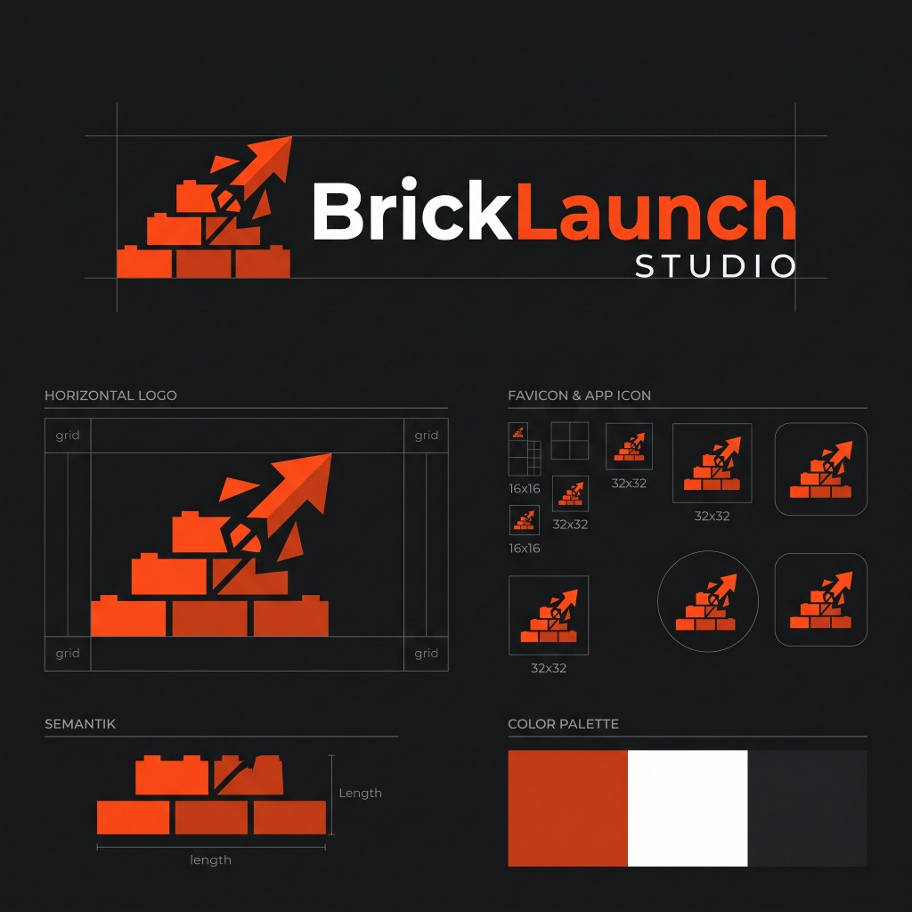
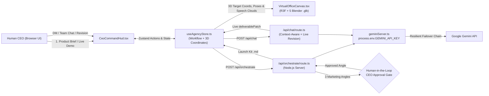

<p align="center">
  
</p>

<h3 align="center">From Raw Idea to Launch-Ready Digital Product — Orchestrated by Autonomous Agents.</h3>

<p align="center">
  
  
  
  
  
  
  
  
</p>

---

**BrickLaunch Studio** adalah aplikasi web **Autonomous Digital Product Launch Agency** yang menggabungkan **simulasi kantor virtual 3D interaktif (WebGL / Blender `.glb`)** dengan **orkestrasi multi-agent AI nyata berbasis Google Gemini API**.

Sebagai **Human CEO**, kamu cukup memasukkan ide produk digital mentah — lalu saksikan 7 karakter Lego minifigure AI (**Alex**, **Maya**,**Sora**,**Raka**,**Bima**, **Nadia** dan **Leo**) berjalan, duduk di kursi kerja, berdiskusi melalui balon awan pesan 3D, meminta persetujuanmu di Gerbang ACC (**Human-in-the-Loop**), menerima revisi langsung lewat DM/Chat, hingga mencetak **Launch Kit Markdown (`.md`)** di mesin fotokopi kantor.

---

## Identitas Brand & Pemetaan Ortografis

<p align="center">
  
</p>

| Aset Brand | Lokasi File | Penempatan di UI & Metadata | Fungsi |
| :--- | :--- | :--- | :--- |
| **Favicon & App Icon** *(Mark piramida 3 tingkat lego brick + panah peluncuran diagonal di atas latar `#141517`)* | `src/app/icon.svg` & `public/brand/bricklaunch-icon.svg` | `<head>` metadata (`icon`, `shortcut`, `apple`), tab browser `16×16` / `32×32`, dan bookmark | Ikon presisi tinggi tanpa teks agar tetap tajam pada ukuran mikro |
| **Horizontal Header Lockup** *(Icon Mark di kiri + `Brick` putih + `Launch` `#F04A1A` + `STUDIO` rata kanan)* | `src/components/ui/BrickLaunchLogo.tsx` & `public/brand/bricklaunch-logo-horizontal.svg` | Top Bar HUD, Header Modal *Agency Profile / How It Works*, OpenGraph & Hero README | Identitas utama studio di antarmuka web dan pratinjau tautan |

### Palet Warna Brand
- **Brick Launch Orange:** `#FF521B` → `#E84118` → `#B93110` (energi peluncuran, aksen CTA, serpihan momentum)
- **Studio Pure White:** `#FFFFFF` (tipografi `Brick`, `STUDIO`, dan kontras bersih)
- **Obsidian Charcoal:** `#141517` / `#0F172A` (latar belakang elegan untuk menonjolkan pencahayaan studio 3D)

---

## Tech Stack

| Kategori | Teknologi | Peran dalam Sistem |
| :--- | :--- | :--- |
| **Framework & Runtime** | Next.js 15 (App Router, Node.js Runtime) + React 19 + TypeScript 5 | SSR-safe routing, Server API Routes (`/api/orchestrate`, `/api/chat`), production bundling |
| **AI & Multi-Agent Engine** | `@google/genai` (Google Gemini SDK) | Orkestrasi riset pasar, sintesis 3 marketing angle, penulisan Launch Kit, dan chat revisi live dengan failover model otomatis (`gemini-3.5-flash-lite` → `gemini-3.1-flash-lite` → `gemini-3.8-flash` → `gemma-4`) |
| **3D Engine & WebGL** | Three.js, `@react-three/fiber` v9, `@react-three/drei` v10 | Render 5 aset Blender `.glb`, animasi sendi minifigure Lego (jalan, duduk 90°, mengetik, kopi, melambai, copier), `<Environment>`, `<ContactShadows>`, `<OrbitControls>` |
| **State & Spatial Choreography** | Zustand v5 (`src/store/useAgencyStore.ts`) | Mesin state tunggal yang menyinkronkan fase orkestrasi AI, koordinat spasial 3D, rotasi aktivitas standby, log telemetri, dan jendela obrolan |
| **UI & Styling** | Tailwind CSS v4 + Lucide React | Floating Glassmorphism HUD yang bisa digulir & dibentangkan (*collapsible/expandable*), Mode Lega, Approval Modal, dan Tabbed Deliverable Drawer |

---

## Definisi Arsitektur Sistem

BrickLaunch Studio memisahkan secara ketat **lapisan keamanan AI di server** dan **lapisan koreografi 3D + HUD di browser** (*Zero Client API Key Exposure*):



### Prinsip Arsitektur & Keamanan
1. **Zero Client API Key Exposure:** `process.env.GEMINI_API_KEY` (dengan fallback `process.env.GOOGLE_API_KEY`) hanya pernah dibaca di server pada `src/lib/geminiServer.ts`. Tidak ada input API key, modal pengaturan key, atau penyimpanan `localStorage` di frontend.
2. **Resilient Multi-Model Failover:** Wrapper `generateWithResilience()` menerapkan konfigurasi standar (`temperature: 0.7`, `maxOutputTokens: 1200` untuk orkestrasi / `500` untuk chat cepat, tanpa parameter eksperimental seperti `thinkingConfig`), dilengkapi timeout cepat dan failover lintas bucket kuota model untuk ketahanan terhadap lonjakan `503`/`429`.
3. **Hydration-Safe & Optimized WebGL:** Kedua komponen utama (`VirtualOfficeCanvas` dan `CeoCommandHud`) menggunakan guard `isMounted` serta `ssr: false` dengan `<Canvas dpr={[1, 1.5]}>` dan `<Html>` yang ter-mount permanen (bebas error unmount sinkron React 19).
4. **Live Revision Loop via Chat:** Setiap pesan DM ke Alex/Leo otomatis membawa konteks proyek penuh (`ceoBrief`, `researchSummary`, `selectedAngle`, `finalDeliverable`). Ketika terdeteksi niat revisi, server memperbarui bagian Launch Kit terkait dan langsung memicu animasi Leo bekerja → mencetak ulang di copier → memperbarui file `.md`.

---

## Seluruh Peran Agent (7 Divisi Setara — Lego Minifigure Roster)

| Agent | Divisi & Peran | Warna Seragam | Zona Meja `[X, Y, Z]` | Kepribadian & Tanggung Jawab |
| :--- | :--- | :--- | :--- | :--- |
| **Alex** (`manager`) | **AI Manager / Handoff Orchestrator** | `#1E293B` *(Dark Navy)* · Aksen `#60A5FA` | `MANAGER_DESK` `[-3.5, 0, -2.5]` | **Tenang, terstruktur, tegas, dan suportif.** Memimpin 7 divisi, menyintesis 3 Marketing Angle kontras, menjaga gerbang ACC CEO, dan mengoordinasikan revisi lintas divisi. |
| **Maya** (`researcher`) | **Market & Psychology Researcher** | `#0284C7` *(Sky Blue)* · Aksen `#38BDF8` | `RESEARCHER_DESK` `[-4.0, 0, 1.5]` | **Analitis, penasaran, data-driven.** Membedah pain point terdalam, psikologi konsumen, dan celah kompetitor (mendukung Google Search Grounding opsional). |
| **Leo** (`copywriter`) | **Conversion Copywriter** | `#D97706` *(Amber)* · Aksen `#FBBF24` | `COPYWRITER_DESK` `[-1.0, 0, 1.5]` | **Punchy, kreatif, fokus konversi.** Menulis **Landing Page Copy**, **Utas Viral 5-bagian**, dan **Skrip Video 45d**, serta mencetak paket final di Copier Zone. |
| **Sora** (`social`) | **Social Media Specialist** | `#DB2777` *(Vibrant Pink)* · Aksen `#F472B6` | `SOCIAL_DESK` `[1.5, 0, 1.5]` | **Trend-savvy, ceria, community-driven.** Merancang **Kalender Konten 7 Hari** multi-platform (TikTok, IG Reels, X/Threads, LinkedIn) dan strategi distribusi organik. |
| **Raka** (`finance`) | **Finance & Pricing Strategist** | `#059669` *(Emerald)* · Aksen `#34D399` | `FINANCE_DESK` `[-4.0, 0, 3.6]` | **Presisi angka & pragmatis.** Menyusun **Pricing Tier**, promo early-bird, unit economics, net margin, break-even point & proyeksi revenue Bulan 1. |
| **Nadia** (`hr`) | **Human Resources & Team Ops** | `#7C3AED` *(Royal Violet)* · Aksen `#A78BFA` | `HR_DESK` `[-1.0, 0, 3.6]` | **Hangat, suportif, teratur.** Mengatur kapasitas tim, **SOP Operasional Launch**, SLA respon pembeli, onboarding customer & pencegahan burnout tim. |
| **Bima** (`qc`) | **Product QC & Launch Auditor** | `#DC2626` *(Crimson Red)* · Aksen `#F87171` | `QC_DESK` `[1.5, 0, 3.6]` | **Teliti, perfeksionis, ketat standar.** Memimpin **Pre-Launch Product QC Gate** — mengaudit konsistensi copy, angka pricing, jadwal sosmed & SOP sebelum memberi sertifikat LOLOS QC dan izin cetak. |

### Alur Kerja 7-Tahap Human-in-the-Loop + Pre-Launch QC
1. **CEO Brief** — CEO mengetik ide produk digital atau mengklik 1-klik **Run Sample Launch Mission**.
2. **Riset Pasar, Finance & Kesiapan HR** — Maya membedah pasar, Raka memvalidasi kelayakan margin awal, dan Nadia mengecek kapasitas 7 divisi.
3. **Alex Pre-Production Report** — Maya melakukan handoff ke Meja Manager; Alex merangkum **3 Marketing Angle** berbeda.
4. **CEO Approval Gate (HITL)** — Studio berhenti di modal persetujuan agar Human CEO memilih 1 angle pemenang.
5. **Produksi Serentak 4 Divisi** — Leo (Copy), Sora (Social Media), Raka (Finance), dan Nadia (HR) bekerja serentak di meja masing-masing.
6. **Pre-Launch Product QC Gate (Bima)** — Sebelum dicetak, paket diserahkan ke meja **Bima (`QC_DESK`)** untuk audit menyeluruh (`/100`) & sertifikasi siap rilis.
7. **Copier Printing, Ekspor `.md` 7-Divisi & Revisi Live** — Setelah lolos QC, Leo mencetak Launch Kit lengkap di `COPIER_PRINTER_ZONE` dan CEO dapat DM divisi mana saja untuk revisi live.

---

## Agent Behavioral Smart Contracts & SOP Engine

Untuk memastikan seluruh 7 divisi selalu menghasilkan deliverable **publish-ready berstandar agensi** (bukan ringkasan pendek 4–5 baris atau klise marketing generik), setiap agent kini terikat pada **Behavioral Smart Contract** ketat yang didefinisikan di [`src/lib/agents/behavioralContracts.ts`](./src/lib/agents/behavioralContracts.ts) dan diinjeksi langsung ke pipeline 3-tahap pada [`src/app/api/orchestrate/route.ts`](./src/app/api/orchestrate/route.ts).

### Prinsip Kontrak Perilaku Global (`GLOBAL_AGENCY_RULES`)
1. **Zero-Fluff & Anti-Generic Rule:** Melarang kalimat filler generik, placeholder kosong (`[isi di sini]`), atau bullet 1 baris tanpa konteks nyata.
2. **Autonomous Brief Expansion:** Bahkan jika CEO hanya mengetik 3–6 kata (mis. *"Jual ebook panduan fatloss untuk pemula"*), setiap agent wajib mengekspansi avatar pembeli, skenario harian, modul nyata, dan angka finansial IDR secara otonom.
3. **Cross-Agent Context Passing (3-Stage Grounded Pipeline):**
   - **Stage 1 (Paralel):** Raka (Finance), Sora (Social Media), dan Nadia (HR) menerima dossier psikologi lengkap dari Maya.
   - **Stage 2 (Grounded Copywriting):** Leo menerima **Pain Points, 3 Hidden Objections & 5 VoC Phrases Maya** *sekaligus* **3-Tier Harga Exact IDR & Promo Early-Bird Raka**, sehingga copy landing page & Post 7/7 sinkron 100% tanpa kontradiksi.
   - **Stage 3 (Genuine 5-Dimension QC Audit):** Bima menerima seluruh output nyata Maya, Leo, Sora, Raka, dan Nadia untuk mengeluarkan skor per divisi dan Sertifikat Audit resmi.

### Kontrak & Kalibrasi Parameter per Divisi

| Agent | Temp | Token Budget | Struktur Output Wajib dalam Smart Contract |
| :--- | :---: | :---: | :--- |
| **Alex** (`manager`) | `0.7` | `4,096` | Executive Creative Brief (*Core Promise, Unique Mechanism, Primary Avatar*) + 3 Angle kontras (*Pain/Anti-Mainstream*, *Speed/Shortcut*, *Identity/Lifestyle*) lengkap dengan rasional **`whyItConverts`**. |
| **Maya** (`researcher`) | `0.4` | `4,096` | Target Avatar Profile + **5 Visceral Pain Points** (*External* & *Internal*) + **3 Hidden Objections & Neutralizers** + Competitor Gap Analysis + **5 Exact Voice-of-Customer (VoC) Phrases**. |
| **Leo** (`copywriter`) | `0.7` | `8,192` | **A.** Full Landing Page Script **8 seksi lengkap (500–750+ kata)**; **B.** **7-Post Connected Launch Thread** (`1/7`–`7/7`); **C.** **45–60s Video Script** dengan timestamp eksplisit + `[VISUAL]`, `[TEXT ON SCREEN]`, `[VOICEOVER]`. |
| **Sora** (`social`) | `0.7` | `4,096` | Tabel Markdown **Day 1–Day 7 Multi-Platform Content Calendar** (TikTok, IG Reels, X/Threads, LinkedIn) dengan *Exact Scroll-Stopping Hook* + **3 Community Growth Tactics** (termasuk funnel Comment-to-DM). |
| **Raka** (`finance`) | `0.4` | `4,096` | **3-Tier Pricing Architecture (IDR)** + Early-Bird Strategy + Unit Economics (fee, CAC organik/ads, Gross & Net Margin %) + BEP + **Tabel Proyeksi Bulan 1 (3 Skenario: Conservative, Realistic, Optimistic)**. |
| **Nadia** (`hr`) | `0.4` | `4,096` | Timeline SOP **`H-3`, `H-0`, `H+1..H+7`** + **Buyer Response SLA Matrix Table** (WhatsApp, DM, Email + eskalasi) + **3-Step Post-Purchase Onboarding Flow** (`T+0`, `Day-1`, `Day-5`). |
| **Bima** (`qc`) | `0.4` | `4,096` | Audit **5 Dimensi Lintas Divisi** + **Product QC Certificate** (Skor `/100`, mini-skor 5 divisi, *Copy vs Pricing*, *Social vs Funnel*, *SOP vs SLA*, *Strengths*, *Refinement Notes*) + **BAB 7 Go-Live Sign-Off**. |

### Metrik Perbandingan Kapasitas Output Agent: Sebelum vs. Sesudah Behavioral Smart Contracts

| Dimensi Evaluasi | Sebelum Smart Contracts *(v1/v2)* | Sesudah Smart Contracts *(v3 Agency-Grade)* | Peningkatan Kapasitas |
| :--- | :--- | :--- | :--- |
| **Batas Token Output (`maxOutputTokens`)** | `1,200` token (dibagi bersama untuk 7 divisi dalam 1 panggilan) | `4,096` token/divisi & **`8,192` token khusus Leo** (total kapasitas hingga `28,672` token/misi) | **~24× kapasitas konteks output** |
| **Kalibrasi Temperatur Model** | Seragam `0.7` untuk semua agent (termasuk Finance & QC) | Terkalibrasi per peran: `0.7` (Kreatif: Alex, Leo, Sora) · `0.4` (Analitis/Audit: Maya, Raka, Nadia, Bima) | **Presisi angka & audit jauh lebih konsisten** |
| **Kedalaman Landing Page (Leo)** | Ringkasan singkat 4–5 baris (~60–90 kata), struktur bebas | **8 Seksi Lengkap publish-ready** (`500–750+ kata`) termasuk Value Stack, Before/After & FAQ keberatan | **~8× lebih mendalam & siap langsung tayang** |
| **Utas Peluncuran & Skrip Video (Leo)** | 5 post ringkas + 3 baris skrip video tanpa arahan produksi | **Tepat 7 Post terhubung** + **Skrip Video 45–60d bertimestamp** lengkap dengan `[VISUAL]`, `[TEXT ON SCREEN]`, `[VOICEOVER]` | **100% siap rekam & publish tanpa tulis ulang** |
| **Riset Pasar & Psikologi (Maya)** | Paragraf ringkasan 4–6 kalimat umum | 5 Bagian terstruktur: Avatar, 5 External/Internal Pain Points, 3 Hidden Objections + Neutralizer, Gap Analysis, 5 VoC Phrases | **~6× kedalaman psikologi pembeli** |
| **Kalender Social Media (Sora)** | 4–5 bullet ringkas tanpa hook konkret | **Tabel Markdown H1–H7** lintas 4 platform + exact hook + **3 taktik funnel komunitas** (auto-DM, poll, lead magnet) | **Eksekusi distribusi siap jalan 7 hari penuh** |
| **Pemodelan Keuangan (Raka)** | 2–3 baris kisaran harga & estimasi kasar | **3-Tier IDR Architecture**, Early-Bird, Unit Economics (CAC/Margin), BEP exact & **Tabel Proyeksi 3 Skenario Bulan 1** | **Setara dokumen financial plan agensi** |
| **Operasional & SLA (Nadia)** | 3–4 bullet SOP umum | Timeline `H-3 / H-0 / H+1..H+7` + **Matriks SLA per kanal** + **Onboarding 3-Tahap** penekan refund | **Zero operational blind-spot saat launch** |
| **Sinkronisasi Lintas Divisi & Audit (Bima)** | 1 panggilan tunggal tanpa konteks nyata antar-divisi; QC generik | **Cross-Agent Context Passing nyata** (Maya + Raka → Leo → Bima) + **Audit 5 Dimensi & Mini-Skor per Divisi** | **Zero inkonsistensi harga vs copy; audit terverifikasi** |
| **Reliabilitas Parsing Markdown Panjang** | Rentan gagal JSON escaping pada naskah panjang | Delimiter blok eksplisit (`<<<LANDING_PAGE>>>`, `<<<LAUNCH_THREAD>>>`, `<<<VIDEO_SCRIPT>>>`) untuk aset long-form | **100% tahan format tabel, kutipan & Markdown kaya** |

---

## Detail Profil Kantor Virtual 3D — Kampus Dual-Wing (24m × 10m)

Kantor virtual **BrickLaunch Studio** membentang luas **24m × 10m** pada sumbu X (`X: [-12, +12]`, `Z: [-5, +5]`) menggunakan dua instans `office_room.glb` yang dihubungkan oleh **partisi kaca arsitektural di `X = 0`** dan **pintu berengsel otomatis ber-sensor jarak (`2.2m`) di `[0, 0, -0.5]`**:

### Peta Koordinat Zona Kampus (`OFFICE_ZONES`)

| Sayap / Zona | Koordinat `[X, Y, Z]` | Aset 3D & Fungsi Operasional |
| :--- | :--- | :--- |
| **West Wing Shell** | `[-6.0, 0.0, 0.0]` | `office_room.glb` (12m × 10m) — Sayap Executive, Intelligence & Creative. |
| **Manager Desk (Alex)** | `[-9.2, 0.0, -2.5]` | `workstation_desk.glb` + kursi ergonomis + titik handoff eksekutif. |
| **Researcher Desk (Maya)** | `[-9.5, 0.0, 1.8]` | `workstation_desk.glb` + kursi ergonomis + halo aktif riset psikologi pasar. |
| **Copywriter Desk (Leo)** | `[-6.2, 0.0, 1.8]` | `workstation_desk.glb` + kursi ergonomis + penulisan BAB 3 Launch Kit. |
| **Social Media Desk (Sora)** | `[-3.0, 0.0, 1.8]` | `workstation_desk.glb` + kursi ergonomis + penyusunan BAB 4 Kalender 7 Hari. |
| **Copier / Printer Zone** | `[-4.2, 0.0, -3.5]` | `office_copier.glb` dengan beacon LED ungu & animasi lembaran cetak `.md`. |
| **Animated Connecting Door** | `[0.0, 0.0, -0.5]` | Pintu kaca/oak berengsel dengan sensor proximity `2.2m` (membuka mulus `Math.PI / 2.2`) + waypoint routing otomatis lintas sayap. |
| **East Wing Shell** | `[6.0, 0.0, 0.0]` | `office_room.glb` kedua (12m × 10m) — Sayap Finance, Operations, QC & Pantry. |
| **Finance Desk (Raka)** | `[3.0, 0.0, 1.8]` | `workstation_desk.glb` + kursi ergonomis + penyusunan BAB 5 Pricing & Proyeksi. |
| **HR Desk (Nadia)** | `[6.2, 0.0, 1.8]` | `workstation_desk.glb` + kursi ergonomis + penyusunan BAB 6 SOP & SLA. |
| **QC Product Desk (Bima)** | `[9.2, 0.0, 1.8]` | `workstation_desk.glb` + kursi ergonomis + audit Sertifikat QC & BAB 7 Go-Live. |
| **Pantry Coffee Bar** | `[8.5, 0.0, -2.2]` | `pantry_bar.glb` + mesin espresso tempat rehat kopi tim dari kedua sayap. |

### Katalog 5 Aset 3D Blender (`public/models/`)
- `office_room.glb` — Struktur cutaway isometrik ruang kantor modern.
- `workstation_desk.glb` — Meja workstation studio (di-instance 3× dengan material oak + rangka baja charcoal PBR).
- `pantry_bar.glb` — Unit kabinet pantry & bar kopi terintegrasi.
- `office_copier.glb` — Mesin fotokopi multifungsi (MFP) untuk fase cetak deliverable.
- `lego_agent.glb` — Model karakter Lego minifigure dengan repivot sendi anatomis (`Minifig_Leg_L/R` di pinggul `Y=0.64`, `Minifig_Arm_L/R` + tangan di bahu `Y=1.15`) untuk animasi jalan, duduk 90° di kursi, mengetik, menyeruput kopi, melambai, dan serah terima dokumen.

### Aktivitas Standby Otonom & Manajemen HUD
- **Autonomous Standby Life:** Saat studio sedang `IDLE` atau `COMPLETED`, ketiga agent berotasi secara alami — satu duduk di meja kantor, satu bersantai memegang cangkir kopi di Pantry Bar, dan satu berjalan-jalan santai melintasi 7 titik terbuka ruangan.
- **Auto-Hide 3 Menit:** Baik balon awan pesan 3D di atas karakter maupun jendela popup HUD obrolan memiliki durasi tampil otomatis **3 menit** sebelum menghilang mulus agar pandangan studio tetap lega.
- **Kamera Cepat & Mode Lega:** Mendukung 4 fokus kamera halus (`Overview`, `Workstations`, `Pantry Bar`, `Copier`), HUD perintah bawah yang bisa **digulir tutup & dibentangkan**, serta tombol 1-klik **Mode Lega** untuk tampilan 3D penuh.

---

## Screenshots & Visual Showcase

> Letakkan hasil tangkapan layar aplikasi berjalan Anda di folder `docs/screenshots/` menggunakan nama file berikut agar otomatis tampil rapi di halaman GitHub:

| Tampilan | Pratinjau / Path File | Deskripsi |
| :--- | :--- | :--- |
| **Brand Identity & Orthography** | `docs/assets/brand-orthography.jpg` *(tersedia)* | Spesifikasi logo horizontal header, grid favicon `16×16` / `32×32`, dan palet warna resmi |
| **3D Virtual Office Overview** | `docs/screenshots/01-office-overview.png` | Tampilan keseluruhan studio `12m × 10m` dengan Alex, Maya, Leo, dan HUD Glassmorphism |
| **Human-in-the-Loop Approval Gate** | `docs/screenshots/02-ceo-approval-gate.png` | Modal persetujuan CEO berisi hasil riset Maya dan 3 pilihan Marketing Angle dari Alex |
| **Live DM Revision & Launch Kit** | `docs/screenshots/03-live-revision-deliverable.png` | Obrolan revisi real-time ke Leo/Alex + Drawer Launch Kit 3 tab dengan ekspor `.md` |

---

## Struktur Direktori

```text
bricklaunch-studio/
├── docs/
│   ├── assets/
│   │   └── brand-orthography.jpg       # Lembar ortografis resmi logo & favicon
│   └── screenshots/                    # Folder screenshot dokumentasi GitHub
├── public/
│   ├── brand/
│   │   ├── bricklaunch-icon.svg        # Favicon & App Icon vector
│   │   └── bricklaunch-logo-horizontal.svg
│   └── models/                         # 5 aset 3D Blender (.glb)
│       ├── lego_agent.glb
│       ├── office_copier.glb
│       ├── office_room.glb
│       ├── pantry_bar.glb
│       └── workstation_desk.glb
└── src/
    ├── app/
    │   ├── api/
    │   │   ├── chat/route.ts           # Context-aware DM/Team Chat & Live Revision API
    │   │   ├── agent-chat/route.ts     # Alias kompatibel ke /api/chat
    │   │   └── orchestrate/route.ts    # START_BRIEF & APPROVE_ANGLE Multi-Agent API
    │   ├── globals.css
    │   ├── icon.svg                    # Next.js App Router auto-favicon
    │   ├── layout.tsx                  # Metadata SEO, OpenGraph & Favicon
    │   └── page.tsx                    # Entrypoint Client-Safe 3D Studio + HUD
    ├── components/
    │   ├── 3d/
    │   │   ├── agentLivePositions.ts   # Registry posisi 60fps untuk sensor pintu otomatis 2.2m
    │   │   ├── LegoAgent.tsx           # Animasi 7 minifigure, pose duduk, waypoint pintu & cloud 3D
    │   │   ├── OfficeEnvironment.tsx   # Kampus Dual-Wing 24x10m, 7 meja + kursi, pintu otomatis, pantry & copier
    │   │   └── VirtualOfficeCanvas.tsx # R3F Canvas (dpr 1..1.5), lighting & 4 preset kamera
    │   └── ui/
    │       ├── BrickLaunchLogo.tsx     # Komponen SVG Icon & Horizontal Header Lockup
    │       └── CeoCommandHud.tsx       # Glassmorphism HUD, Live Demo, Chat Revisi 7 Divisi & 7-BAB .md Export
    ├── lib/
    │   ├── agents/
    │   │   └── behavioralContracts.ts  # Smart Contracts, SOP ketat, kalibrasi temp & token budget 7 agent
    │   ├── assetPath.ts                # Helper basePath untuk localhost, Vercel & GitHub Pages
    │   ├── geminiServer.ts             # Server-only Gemini client + failover model chain
    │   └── staticDemoEngine.ts         # Engine showcase statis berstandar agensi 7-BAB (GitHub Pages)
    └── store/
        └── useAgencyStore.ts           # Zustand multi-agent & Dual-Wing spatial choreography store
```

---

## Menjalankan Lokal & Deployment Vercel

### 1. Instalasi & Konfigurasi Environment
```bash
npm install
cp .env.example .env.local
```

Isi `.env.local` (hanya dibaca di server):
```env
GEMINI_API_KEY=your_google_gemini_api_key
# Opsional: aktifkan Google Search Grounding jika menggunakan key dengan billing aktif
# ENABLE_SEARCH_GROUNDING=true
# Opsional: override model utama
# GEMINI_MODEL=gemini-3.5-flash-lite
```

### 2. Jalankan Mode Pengembangan
```bash
npm run dev
```
Buka `http://localhost:3000` di browser.

### 3. Production Build, GitHub Pages & Deployment Vercel

#### A. Deploy Otomatis ke GitHub Pages (Interactive 3D Static Showcase)
Repositori ini sudah dilengkapi GitHub Actions workflow resmi [`.github/workflows/deploy-pages.yml`](./.github/workflows/deploy-pages.yml) dan script `npm run build:pages`:
1. Karena GitHub Pages hanya menghosting file statis (tanpa server Node.js untuk `GEMINI_API_KEY`), workflow otomatis mengekspor seluruh 3D Virtual Office + 5 model `.glb` + alur 7-tahap & live revision ke folder `out/` menggunakan **Static Demo Showcase Engine** (zero API key exposure).
2. Cukup push ke branch `main`, lalu di GitHub buka **Settings → Pages → Source: GitHub Actions**. Situs akan live di `https://<username>.github.io/<nama-repo>/`.

#### B. Deploy Full-Stack ke Vercel (Real-Time Google Gemini API)
```bash
npm run build
npm run start
```
Untuk menjalankan **real-time Gemini API** (`/api/orchestrate` & `/api/chat`) di publik:
1. Push repositori ini ke GitHub.
2. Import proyek di dashboard **Vercel**.
3. Tambahkan Environment Variable `GEMINI_API_KEY` pada **Project Settings → Environment Variables**.
4. Klik **Deploy** — aplikasi langsung berjalan penuh dengan orkestrasi server-side Gemini API.

---

## Author, Hak Cipta & Lisensi Perlindungan Karya

- **Author / Creator:** **Ahmad Syafii** — *AI System Designer*
- **GitHub:** [@brovynrecho01](https://github.com/brovynrecho01)
- **Hak Cipta:** `Copyright © 2026 Ahmad Syafii — AI System Designer. All Rights Reserved.`
- **Lisensi:** **Proprietary Source-Available & Copyright Protection License** — lihat dokumen lengkap pada [`LICENSE`](./LICENSE).

### Ringkasan Perlindungan Karya
- **Diperbolehkan (Dengan Atribusi Penuh):** Meninjau kode sumber, mengevaluasi untuk keperluan portofolio/rekrutmen, serta menjalankan secara lokal untuk studi non-komersial dengan tetap mencantumkan kredit **Ahmad Syafii — AI System Designer**.
- **Dilarang Tanpa Izin Tertulis:** Penggunaan komersial, penjualan ulang (*resale*), *white-labeling* untuk SaaS/agensi, distribusi ulang kode, ekstraksi aset 3D Blender (`.glb`), identitas brand/ortografis logo, maupun **Agent Behavioral Smart Contracts** (`src/lib/agents/behavioralContracts.ts`) tanpa izin tertulis resmi dari pencipta.
- Untuk keperluan lisensi komersial, kolaborasi enterprise, atau pengembangan sistem multi-agent AI kustom, hubungi langsung **Ahmad Syafii** (`broahmadsyaf@gmail.com`).
